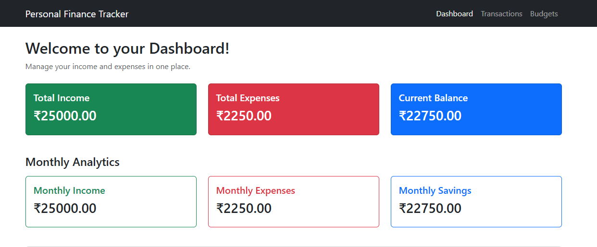
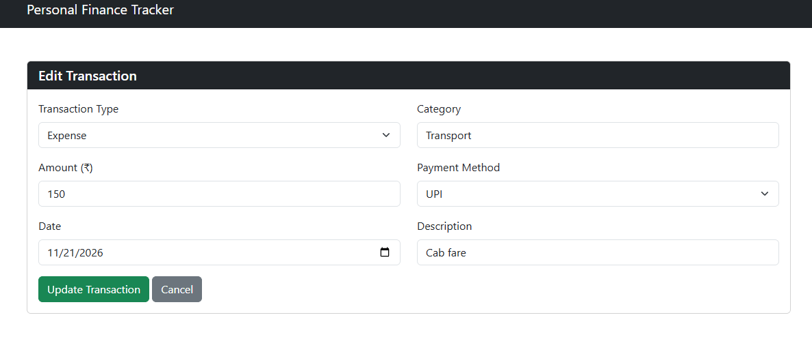
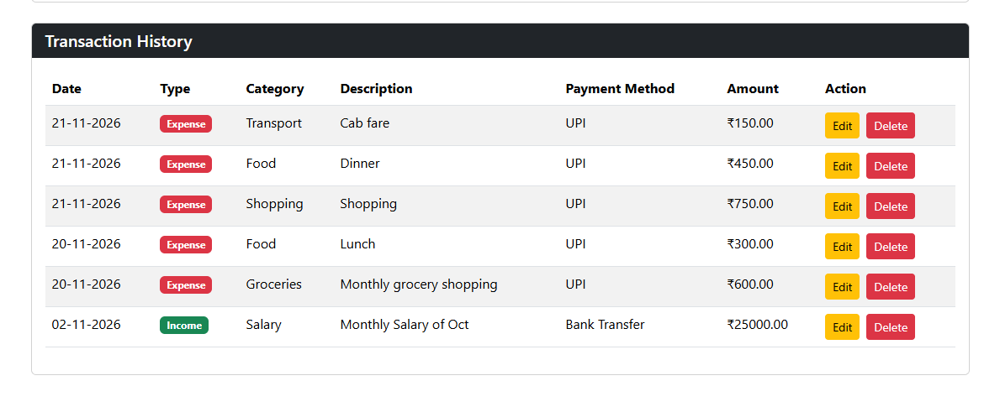

# Personal Finance Tracker

A Python-based web application that helps users manage their personal finances by tracking income, expenses, transactions, and monthly savings using MongoDB.

## Project Overview

The Personal Finance Tracker provides a simple dashboard to record and manage financial transactions. It calculates income, expenses, savings, and current balance while organizing expenses by category.

## Features

* Add income and expense transactions.
* View transaction history.
* Edit existing transactions.
* Delete transactions.
* Calculate total income and expenses.
* Display current account balance.
* Calculate monthly income, expenses, and savings.
* Categorize expenses for better tracking.
* Store transaction records in MongoDB.
* Visualize expense distribution using interactive pie charts.

## Technologies Used

* Python
* Flask
* MongoDB
* PyMongo
* HTML
* Jinja2
* python-dotenv
* Chart.js
* JavaScript

## Project Structure

```text
personal-finance-tracker/
│
├── app.py
├── requirements.txt
├── .gitignore
│
└── templates/
    ├── index.html
    └── edit_transaction.html
```

## Installation and Setup

### 1. Clone the repository

```bash
git clone https://github.com/Vinusha-03/personal-finance-tracker.git
```

### 2. Open the project directory

```bash
cd personal-finance-tracker
```

### 3. Create a virtual environment

```bash
python -m venv venv
```

Activate it on Windows:

```bash
venv\Scripts\activate
```

### 4. Install dependencies

```bash
pip install -r requirements.txt
```

### 5. Configure environment variables

Create a `.env` file in the project root directory.

Add your MongoDB connection string:

```text
MONGO_URI=your_mongodb_connection_string
```

Keep your actual MongoDB credentials private. Never upload your `.env` file to GitHub.

### 6. Run the application

```bash
python app.py
```

Open your browser and visit:

```text
http://127.0.0.1:5000/
```

## Database

MongoDB is used to store transaction records.

**Database:** `personal_finance`

**Collection:** `transactions`

Each transaction contains information such as:

* User ID
* Transaction type
* Category
* Amount
* Payment method
* Date
* Description

## Learning Outcomes

* Python application development
* Flask web framework
* MongoDB database connectivity
* CRUD operations
* Environment variable management
* HTML templates and Jinja2
* Financial calculations and data handling

## Limitations

This is an educational single-user project. It currently uses a fixed user ID and does not implement user authentication or multi-user access.
---

## Screenshots

### 1. Main Dashboard



### 2. Add New Transaction


### 3. Edit Transaction



### 4. Expense Distribution – Pie Chart


### 5. Transaction History




## Author

**Vinusha Dmello**

GitHub: https://github.com/Vinusha-03

